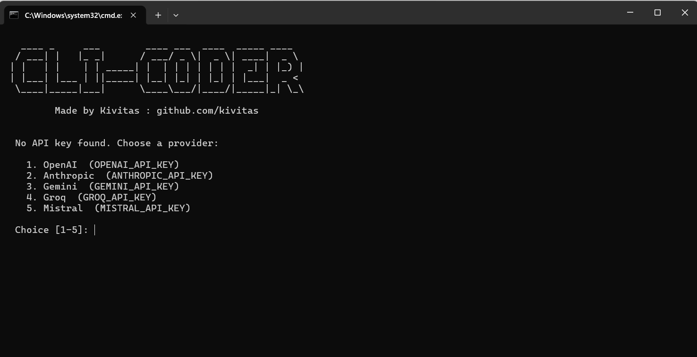

# CLI CODER

[](https://github.com/Kivitas/CLI-CODER/actions/workflows/ci.yml)
[](LICENSE)

A lightweight, zero-setup terminal AI assistant and coding agent. Built for Windows. The test suite also runs on Ubuntu in CI.

CLI CODER gives you a streaming chat with any major model provider, plus a coding agent (`mini-swe-agent`) that can edit files and run commands in your project. It reports token use and cost as you go.



## Features

- **Zero setup on Windows**: build the launcher once (see [INSTALLATION.md](INSTALLATION.md)). It installs `uv`, creates a Python environment, and applies the Windows patches for you.
- **Eight providers out of the box**: OpenAI, Anthropic (Claude), Google Gemini, xAI (Grok), OpenRouter, Groq, Mistral, and Ollama for models that run on your own machine. Any [LiteLLM](https://docs.litellm.ai/docs/providers) model string works with `/model`.
- **Markdown rendering**: replies are formatted as they stream in (headings, lists, code blocks).
- **Token and cost tracking**: every reply shows tokens and cost, and `/info` shows session totals.
- **Long chats stay within budget**: older messages are left out of each request when the context budget is reached. They stay in `/history` and `/save`.
- **Retry and copy**: `/retry` regenerates the last answer, and `/copy` puts it on the clipboard.
- **One-shot mode**: `python main.py "question"` prints one answer and exits, which suits scripts.
- **Coding agent**: `/code <task>` runs an autonomous agent for bugs and features, then lists every file it created, changed or deleted. Simple requests like `/code summarize` take a fast path instead.
- **Hermes Agent**: `/hermes` launches Nous Research's persistent-memory agent and offers to install it if it is missing.
- **Workspace tools**: `/ls`, `/tree`, `/read`, `/run` and `/analyze` work from inside the chat. `/run` has a timeout and can be interrupted with Ctrl+C.
- **Tested**: unit tests and linting run in GitHub Actions on Windows and Ubuntu.

## Quick start

### Windows (launcher)

1. Clone or download this repository.
2. Build `cli_coder.cmd` once, as described in [INSTALLATION.md](INSTALLATION.md).
3. Double-click `cli_coder.cmd`. It sets everything up and starts the chat.

### From source

```bash
python -m venv .venv
.venv\Scripts\activate          # Windows (use source .venv/bin/activate elsewhere)
pip install -r requirements.txt
python patch_deps.py            # Windows only, applies the mini-swe-agent fixes
python main.py
```

The first run asks you to pick a provider. It then asks for that provider's API key, or for the Ollama server address, and saves the result to `.env` (git-ignored).

## Providers

The first run asks you to pick one. Run `/key` later to add or switch providers, and `/models` to see what is set up.

| Provider | Default model | What you need |
|----------|---------------|---------------|
| OpenAI | `openai/gpt-5.6` | `OPENAI_API_KEY` |
| Anthropic (Claude) | `anthropic/claude-sonnet-5-5` | `ANTHROPIC_API_KEY` |
| Google Gemini | `gemini/gemini-3.5-flash` | `GEMINI_API_KEY` |
| xAI (Grok) | `xai/grok-4.6` | `XAI_API_KEY` |
| OpenRouter | `openrouter/openrouter/auto` | `OPENROUTER_API_KEY` (one key, many models) |
| Groq | `groq/openai/gpt-oss-120b` | `GROQ_API_KEY` |
| Mistral | `mistral/mistral-large-latest` | `MISTRAL_API_KEY` |
| Ollama (local) | `ollama_chat/llama3.2` | Nothing. Runs on your machine. Set `OLLAMA_API_BASE` if it is not on `http://localhost:11434`. |

For Ollama, start the server with `ollama serve` and download the model once with `ollama pull llama3.2`.

The defaults are starting points. Switch with `/model <provider/model>` to use any model your provider offers. Model names change often, so check your provider's model list if one stops working.

## Usage

Type normally to chat. Use slash commands for everything else:

```bash
python main.py                          # interactive chat
python main.py "explain this regex"     # one answer, then exit
python main.py --version
```

### Slash commands

| Command | Description |
|---------|-------------|
| `/code <task>` | Coding agent for bugs and features. Simple analysis requests take a fast path. |
| `/hermes [task]` | Launch Hermes Agent (offers to install it first) |
| `/run <cmd>` | Run a shell command with a 120 s timeout. The output goes into the chat. |
| `/ls [pattern]` | List files, with glob support (e.g. `/ls *.py`) |
| `/read <file>` | Load file contents into the chat (supports globs) |
| `/cwd <path>` | Change the working directory |
| `/tree` | Show the directory structure |
| `/analyze` | Summarize the project |
| `/system <msg>` | Set a system prompt (`/system clear` removes it) |
| `/retry` | Regenerate the last reply |
| `/copy` | Copy the last reply to the clipboard (Windows, macOS, or Linux with `xclip`/`wl-copy`) |
| `/history` | Show the conversation log |
| `/save` | Export the chat to a `.md` file in the current folder |
| `/clear` | Clear the chat history and system prompt |
| `/model [name]` | Show or change the model (e.g. `/model anthropic/claude-sonnet-5-5`) |
| `/models` | List providers, their default models, and which are set up |
| `/key` | Set up or switch provider (API key, or the Ollama address) |
| `/info` | Show settings, the context budget, and session token and cost totals |
| `/reset` | Delete the saved config and start fresh |
| `/help` | Show the command list |
| `exit` | Quit |

### Settings

Stored in `.env` next to `main.py`, or set as environment variables:

| Variable | Default | Purpose |
|----------|---------|---------|
| `CLI_CODER_MODEL` | set on first run | Model in use (also changed by `/model`) |
| `CLI_CODER_CONTEXT_CHARS` | `120000` | Characters of history sent per request. Lower it for small-context models. |
| `OPENAI_API_KEY`, `ANTHROPIC_API_KEY`, `GEMINI_API_KEY`, `XAI_API_KEY`, `OPENROUTER_API_KEY`, `GROQ_API_KEY`, `MISTRAL_API_KEY` | none | Provider API keys |
| `OLLAMA_API_BASE` | `http://localhost:11434` | Where your Ollama server listens |

Notes:

- Token counts come from the provider when it reports them. Counts shown with a `~` are estimates.
- Cost comes from LiteLLM's price table. Models it does not know are shown as `cost n/a`.
- `/code` runs the agent in auto-approve mode (`-y`), so it edits files without asking. Run it in a project you are happy to have changed.

## Development

```bash
python -m unittest -v      # run the test suite
ruff check .               # lint
```

See [CONTRIBUTING.md](CONTRIBUTING.md) for the workflow and [ARCHITECTURE.md](ARCHITECTURE.md) for how the pieces fit together. Security issues: see [SECURITY.md](SECURITY.md).

## License

MIT License. See [LICENSE](LICENSE) for details. Made by Kivitas.
